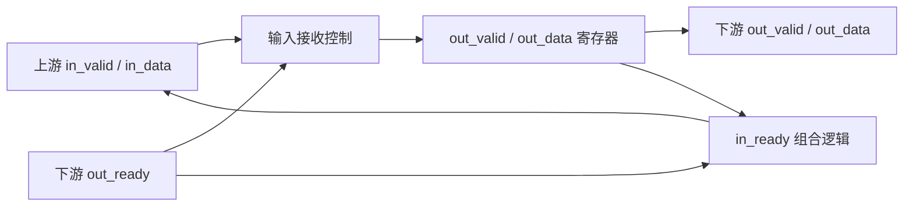

# IP Specification — rv_stage

| Document field | Value |
| --- | --- |
| Document ID | DEMO-RV-001 |
| IP Name | rv_stage（单级 ready/valid 缓冲） |
| Top Module | `rv_stage` |
| Revision | 0.3-demo |
| Status | DRAFT |
| Classification | Public demonstration |
| Date | 2026-10-28 |
| RTL Source Revision | `examples/demo_output/inventory.json` 所记录的源码哈希 |
| Configuration ID | `WIDTH=8`，`examples/tiny_ip/rtl.f` |
| Author / Reviewer / Approver | 示例文档 / 未指定 / 未指定 |

## 1. Document Control（文档信息）

**Table 1-1 — Revision History**

| Rev. | Date | Changes | Author | Review status |
| --- | --- | --- | --- | --- |
| 0.3-demo | 2026-10-28 | 更新中文表述，保留接口与时序依据 | 示例文档 | DRAFT |

## 2. Scope and References（适用范围）

本文描述单模块 `rv_stage` 在 `WIDTH=8` 配置下的行为。输入输出接口见第 6 章；寄存器更新规则见第 8 章；典型传输过程见第 9 章。代码范围为 `rv_stage.v:2-27`。

## 3. IP Overview and Features（功能概述）

`rv_stage` 在上下游之间提供一个寄存器缓冲位置。上游使用 `in_valid/in_ready` 提交数据，下游使用 `out_valid/out_ready` 接收数据。当缓冲位置为空，或下游正在取走旧数据时，模块可以在当前时钟沿接收新数据；当下游不接收时，模块保持已经保存的数据。缓冲深度为 1，不包含多级 FIFO（`rv_stage.v:15-25`）。

## 4. Configuration and Deliverables（配置与交付内容）

**Table 4-1 — Analyzed Configuration**

| Item | Effective value | Source |
| --- | --- | --- |
| DUT top | `rv_stage` | `rv_stage.v:2` |
| Data width | `WIDTH=8`，默认值为 8 | `rv_stage.v:2-4` |
| Source filelist | `rtl.f` → `rv_stage.v` | `rv_stage.v:2` |
| Simulation / debug tools | Synopsys VCS / Verdi | 执行情况见第 12 章 |

本示例交付 IP Spec、模块 Spec、源码索引和 WaveDrom/SVG 时序图。

## 5. Architecture and Hierarchy（整体架构）

该 IP 只有一个模块实例。输入握手控制是否更新 `out_valid` 和 `out_data` 寄存器，寄存器输出直接连接下游接口。`in_ready` 是组合信号，由当前 `out_valid` 和下游的 `out_ready` 共同决定（`rv_stage.v:15-25`）。

**Figure 5-1 — 单级 ready/valid 缓冲结构**

## 6. External Interface Specification（外部接口）

上游在 `clk` 上升沿检查 `in_valid && in_ready`，条件成立时交付一个数据字。下游在 `out_valid && out_ready` 同时为高的上升沿取走输出数据。`in_ready` 为低时，不接收新数据（`rv_stage.v:15-25`）。

**Table 6-1 — Top-Level Signal Definitions**

| Signal | Direction | Width | Clock | Reset/default | Meaning | Timing / condition | RTL source |
| --- | --- | --- | --- | --- | --- | --- | --- |
| `clk` | input | 1 | — | — | 工作时钟 | 上升沿更新寄存器 | `rv_stage.v:5`, `rv_stage.v:17` |
| `rst_n` | input | 1 | `clk` | 低有效 | 复位 | 下降沿即可触发 | `rv_stage.v:6`, `rv_stage.v:17` |
| `in_data` | input | 8 | `clk` | 上游提供 | 输入数据 | 输入握手成立时采样 | `rv_stage.v:7`, `rv_stage.v:23-24` |
| `in_valid` | input | 1 | `clk` | 上游提供 | 输入有效 | 与 `in_ready` 同时为 1 才接收 | `rv_stage.v:8`, `rv_stage.v:21-22` |
| `in_ready` | output | 1 | `clk` | 组合计算 | 可以接收新数据 | `!out_valid \| out_ready` | `rv_stage.v:9`, `rv_stage.v:15` |
| `out_data` | output | 8 | `clk` | 0 | 寄存器输出的数据 | `out_valid=1` 时有效 | `rv_stage.v:10`, `rv_stage.v:18-24` |
| `out_valid` | output | 1 | `clk` | 0 | 输出有效标志 | 空缓冲为 0，有数据为 1 | `rv_stage.v:11`, `rv_stage.v:19-22` |
| `out_ready` | input | 1 | `clk` | 下游提供 | 下游准备接收 | 决定旧数据能否在当前沿取走 | `rv_stage.v:12`, `rv_stage.v:15` |

## 7. Clocks, Resets and CDC（时钟与复位）

**Table 7-1 — Clock/Reset Summary**

| Name | Domain | Frequency / condition | Edge / active level | Behavior | RTL source |
| --- | --- | --- | --- | --- | --- |
| `clk` | 唯一数据时钟域 | 由上层系统提供 | 上升沿 | 更新输出寄存器 | `rv_stage.v:17-25` |
| `rst_n` | 异步复位 | 低有效 | 下降沿有效 | 将 `out_valid`、`out_data` 清零 | `rv_stage.v:17-20` |

复位有效时，缓冲位置为空，组合信号 `in_ready` 随 `out_valid=0` 变为 1。复位释放后，输出寄存器在满足接收条件的时钟上升沿更新。模块内部没有跨时钟域路径（`rv_stage.v:15-25`）。

## 8. Functional Operation（工作原理）

`in_ready = ~out_valid | out_ready`，因此空缓冲可以接收数据；缓冲已满时，只有下游准备接收，才允许新数据替换旧数据（`rv_stage.v:15`）。

在上升沿且 `in_ready=1` 时，`out_valid` 更新为 `in_valid`。如果 `in_valid=1`，`out_data` 同时采样 `in_data`。若 `in_ready=0`，两个寄存器都保持不变。若 `in_ready=1` 且 `in_valid=0`，`out_valid` 清零，但 `out_data` 保留原值；此时旧数据不再有效（`rv_stage.v:17-25`）。

## 9. Timing and Waveform Scenarios（时序与波形）

**Table 9-1 — Timing Scenario Coverage**

| Scenario | Start condition | Key behavior | Figure | Source | Verification |
| --- | --- | --- | --- | --- | --- |
| T-01 | 复位结束后输入 A5，随后下游暂停接收 | 保存 A5 → 等待 → 用 3C 替换 → 清空 | `waveforms/accept_stall_illustrative.svg` | RTL 推导 | 第 12 章 |

上升沿前的 `in_valid`、`in_ready` 决定输入是否被接收。沿后的 `out_valid`、`out_data` 是寄存器更新结果。暂停期间，`out_ready=0` 且缓冲已满，数据保持不变（`rv_stage.v:15-25`）。

**Table 9-2 — 单次传输与停顿周期表**

| Cycle | 沿前输入/下游状态 | 沿后输出 | 解释 |
| --- | --- | --- | --- |
| C0 | `rst_n=0` | `out_valid=0`, `out_data=0` | 复位清空缓冲 |
| C1 | `in_valid=1`, `in_data=A5`, `in_ready=1` | `out_valid=1`, `out_data=A5` | 接收 A5 |
| C2 | `out_ready=0`, `in_ready=0` | 保持 A5 | 下游暂停 |
| C3 | `out_ready=1`, `in_valid=1`, `in_data=3C` | `out_valid=1`, `out_data=3C` | 取走旧数据并写入新数据 |
| C4 | `out_ready=1`, `in_valid=0` | `out_valid=0`, `out_data=3C` | 标记为空，数据寄存器不清零 |
| C5 | 无新输入 | 保持空状态 | 等待下一笔传输 |

**Figure 9-1 — 输入接收、停顿与替换时序（RTL 推导）**

## 10. Register and Memory Map（寄存器与存储器）

N/A：本模块只有数据接口，没有软件可访问的寄存器地址空间。内部的 `out_data` 和 `out_valid` 寄存器在模块 Spec 中列出（`rv_stage.v:5-12`, `rv_stage.v:17-24`）。

## 11. Exceptions, Constraints and Integration（异常与集成要求）

上游必须在每次传输的时钟上升沿满足 `in_valid && in_ready`。当缓冲已满且 `out_ready=0` 时，新输入不会被采样；上游应继续保持待传数据。复位时模块会清空正在保存的数据。复位释放的系统级同步要求由集成环境负责（`rv_stage.v:15-25`）。

## 12. Verification and Evidence（验证记录）

**Table 12-1 — Verification Evidence Matrix**

| Evidence ID | Check | Tool | Input / condition | Artifact | Result |
| --- | --- | --- | --- | --- | --- |
| VE-01 | 端口与源码索引 | Python | `rtl.f` | `inventory.json` | 已生成 |
| VE-02 | 示例时序渲染 | WaveDrom 子集渲染器 | T-01 | `waveforms/accept_stall_illustrative.svg` | 已生成（RTL 推导） |
| VE-03 | VCD 解析器单元测试 | Python | 人工构造的 `fixture.vcd` | `waveforms/fixture_trace.svg` | 解析测试通过 |
| VE-04 | RTL 编译与功能仿真 | Synopsys VCS | — | — | 未执行 |
| VE-05 | FSDB 调试与导出 | Synopsys Verdi | — | — | 未执行 |

## 13. Traceability and Open Issues（源码追溯与待确认事项）

**Table 13-1 — Spec-to-RTL Traceability**

| Clause | Behavior | RTL source | Verification evidence | Open item |
| --- | --- | --- | --- | --- |
| 6 | 顶层接口定义 | `rv_stage.v:5-12` | 源码索引 | — |
| 7 | 异步复位 | `rv_stage.v:17-20` | RTL 分析 | 复位释放策略由系统决定 |
| 8 | 输入握手及寄存器保持 | `rv_stage.v:15-25` | RTL 分析 | — |
| 9 | 暂停与数据替换 | `rv_stage.v:15-25` | RTL 推导波形 | 待 VCS 仿真覆盖 |

## Appendix A. Module Index（模块索引）

- [rv_stage 模块设计说明](modules/rv_stage.md) — `rv_stage.v:2`

## Appendix B. Glossary（术语）

- **ready/valid**：源端报告数据有效、接收端报告可接收的握手方式。
- **FSDB**：Verdi 使用的波形数据库格式。
- **RTL**：寄存器传输级硬件描述。
