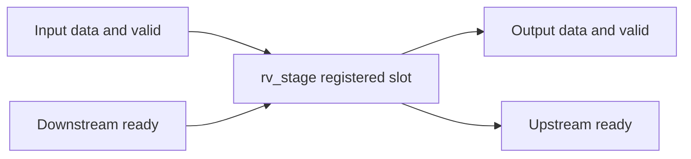

# IP Specification: rv_stage

**Status:** implementation-derived demonstration (NOT SIMULATION-PASS)  
**Active configuration:** `WIDTH=8`, single clock, source `rv_stage.v:2-13`.

## Overview

This IP is a one-entry ready/valid register stage. Its output can be replaced in the same clock where the downstream accepts the old item. A blocked downstream causes output data and validity to hold. See `rv_stage.v:15-24`.

## Hierarchy and Architecture

The example IP contains only `rv_stage`. No resolved child instance appears in `rv_stage.v:2-27`.

## Interfaces

The external input/output ports are `clk`, `rst_n`, `in_data[WIDTH-1:0]`, `in_valid`, `in_ready`, `out_data[WIDTH-1:0]`, `out_valid`, and `out_ready`, declared in `rv_stage.v:5-13`. A transfer is permitted by the combinational `in_ready = !out_valid || out_ready` (`rv_stage.v:15`). Detailed directions and post-edge behavior are in [the module Spec](modules/rv_stage.md).

## Clock and Reset Domains

Single rising-edge `clk` domain; `rst_n` is asynchronously active-low (`rv_stage.v:17-20`). This RTL does not include a reset release synchronizer; that integration concern has not been tested.

## Behavior and Timing

`out_valid` and `out_data` are registered. On each rising edge, if `in_ready`, `out_valid` samples `in_valid` and `out_data` samples `in_data` only when `in_valid` is high; otherwise the registers retain their old values (`rv_stage.v:21-25`). The stage accepts up to one item per rising edge when downstream is always ready. Input acceptance is based on **pre-edge handshake**, whereas diagrams sample **post-edge states** (`rv_stage.v:15-24`).

## Waveform Scenarios

Illustrative, source-derived example of reset, acceptance, stall and replacement; **not simulated**:

Hand-authored VCD parser fixture; **not produced by a simulator, not functional verification**:

The complete cycle table and source references appear in [rv_stage module timing](modules/rv_stage.md#cycle-timing). WaveDrom source files are `waveforms/accept_stall_illustrative.json5` and `waveforms/fixture_trace.json5`.

## Verification

**NOT RUN:** simulator, lint, synthesis, formal equivalence or FPGA testing. The included `fixture.vcd` was written as a parser fixture. The accompanying VCD hash and time sampling metadata do **not** attest that a testbench was executed. File inventory and documentation structural checks are available using the bundled tools.

## Assumptions and Open Questions

`WIDTH=8` is the demonstrated default only; other parameter values and injected `ifdef` configurations are not elaborated. Timing closure, asynchronous reset release and CDC concerns require separate verification. The stable ready/valid interface has no independently proven SVA properties.

## Source Evidence

- `rv_stage.v:2-13` — module and ports.
- `rv_stage.v:15` — readiness combinational equation.
- `rv_stage.v:17-25` — reset, state, and cycle transition logic.

## Module Index

- [rv_stage](modules/rv_stage.md) — `rv_stage.v:2`
