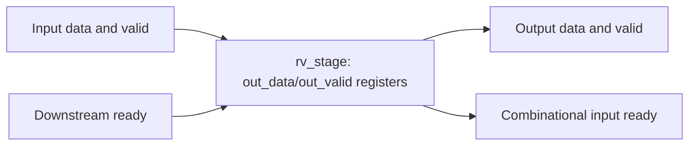
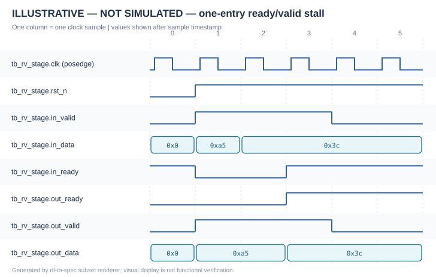
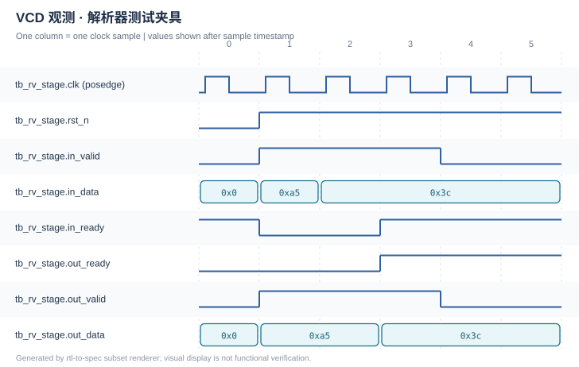

# IP Specification — rv_stage

| Document field | Value |
| --- | --- |
| Document ID | DEMO-RV-001 |
| IP Name | rv_stage (ready/valid register stage) |
| Top Module | `rv_stage` |
| Revision | 0.2-demo |
| Status | DRAFT — example only; not approved for release |
| Classification | Public demonstration |
| Date | 2026-10-28 |
| RTL Source Revision | `examples/demo_output/inventory.json`, SHA256 source snapshot |
| Configuration ID | `WIDTH=8`, `examples/tiny_ip/rtl.f`, source-only review |
| Author / Reviewer / Approver | Demo content / Not assigned / Not approved |

> **Design/evidence notice:** RTL-DERIVED. Synopsys VCS/Verdi were **NOT RUN**. Included VCD was handmade solely for converter tests. No functional verification has been performed.

## 1. Document Control

**Table 1-1 — Revision History**

| Rev. | Date | Description | Author | Approval |
| --- | --- | --- | --- | --- |
| 0.2-demo | 2026-10-28 | Adapted one-slot ready/valid RTL into formal controlled Spec layout | Demo content | Not reviewed |

No reviewer/approver is assigned. Distribution is limited to this public demonstration. Status is DRAFT.

## 2. Scope and References

This document covers only the single module `rv_stage` at `WIDTH=8`. It is a source-derived description, *not* an external ready/valid protocol conformance certificate. Source of truth: `rv_stage.v:2-27` and corresponding inventory file. External clock frequency, physical setup/hold and system-level CDC are excluded.

## 3. IP Overview and Features

`rv_stage` is a one-entry registered staging element for ready/valid data. It accepts input when the output slot is empty or downstream consumes the old word; it holds the output data during stall (`rv_stage.v:15-25`). There are no start/done pins, interrupts, register bus or encrypted datapath in this module.

## 4. Configuration and Deliverables

**Table 4-1 — Analyzed Configuration**

| Item | Effective value | Source / qualification |
| --- | --- | --- |
| DUT top | `rv_stage` | `rv_stage.v:2` |
| Width parameter | `WIDTH=8` (default) | `rv_stage.v:2-10` |
| Clock | Single `clk` rising edge | `rv_stage.v:17` |
| Filelist | `rtl.f` containing `rv_stage.v` | Lexical inventory only |
| EDA | Synopsys VCS + Verdi | NOT RUN; no vendor logs or FSDB available |

Deliverables for this demonstration are `ip_spec.md`, `modules/rv_stage.md`, source inventory and WaveDrom/SVG illustrations. No IP synthesis or EDA sign-off package is included.

## 5. Architecture and Hierarchy

A single registered stage connects input handshake, an occupancy bit and output storage; there are no submodule instances (`rv_stage.v:2-27`). The figure is a conceptual data/control flow consistent with source logic, not a routed netlist.

**Figure 5-1 — Register-stage architectural data flow (RTL-DERIVED).**

## 6. External Interface Specification

**Table 6-1 — Top-Level Signal Definitions**

| Signal | Direction | Width | Clock domain | Reset / default | Meaning | Cycle and handshake | RTL source |
| --- | --- | --- | --- | --- | --- | --- | --- |
| `clk` | input | 1 | clk | N/A | Single capture clock | Rising edge | `rv_stage.v:5`, `rv_stage.v:17` |
| `rst_n` | input | 1 | clk/reset | active-low | Asynchronous reset | Assert without edge | `rv_stage.v:6`, `rv_stage.v:17` |
| `in_data` | input | WIDTH=8 | clk | external | Input word | Capture on accepted valid input | `rv_stage.v:7`, `rv_stage.v:21-24` |
| `in_valid` | input | 1 | clk | external | Input valid | Accepted when `in_ready=1` pre-edge | `rv_stage.v:8`, `rv_stage.v:22` |
| `in_ready` | output | 1 | clk | combinational | Input acceptance readiness | `!out_valid || out_ready` | `rv_stage.v:9`, `rv_stage.v:15` |
| `out_data` | output | WIDTH=8 | clk | 0 | Registered data word | Meaningful when `out_valid=1` | `rv_stage.v:10`, `rv_stage.v:18-24` |
| `out_valid` | output | 1 | clk | 0 | Slot occupied | Registered; holds during stall | `rv_stage.v:11`, `rv_stage.v:19-22` |
| `out_ready` | input | 1 | clk | external | Consumer readiness | Can clear/replace slot at edge | `rv_stage.v:12`, `rv_stage.v:15` |

There is no complete AXI bus implementation or address/control handshake in `rv_stage.v:2-27`. Ports implement this module's local ready/valid contract.

## 7. Clocks, Resets and CDC

**Table 7-1 — Clock/Reset Summary**

| Name | Domain | Frequency | Edge/polarity | Synchrony | State / RTL evidence |
| --- | --- | --- | --- | --- | --- |
| `clk` | only data domain | externally specified / unknown | posedge | synchronous capture | `rv_stage.v:17-25` |
| `rst_n` | asynchronous reset | N/A | active low | asynchronously asserted; release not synchronized here | clears `out_valid` and `out_data`, `rv_stage.v:17-20` |

No clock crossing exists within this one-clock module. Timing closure and reset deassertion constraints must be handled by integration.

## 8. Functional Operation

The combinational `in_ready` equation is `!out_valid || out_ready` (`rv_stage.v:15`). At each non-reset rising edge with `in_ready=1`, `out_valid <= in_valid`; if `in_valid=1`, `out_data <= in_data`. Under stall (`out_valid=1 && out_ready=0`), both registered outputs hold (`rv_stage.v:21-25`). An accepted idle bubble clears the valid bit but preserves stale data, whose bits are ignored while invalid.

## 9. Timing and Waveform Scenarios

**Table 9-1 — Timing Scenario Coverage**

| Scenario ID | Trigger | Expected behavior | Waveform | Provenance | Verified? |
| --- | --- | --- | --- | --- | --- |
| T-01 | reset→accepted word→stall→replacement→drain | output valid/data hold under stall | `waveforms/accept_stall_illustrative.svg` | ILLUSTRATIVE | NOT SIMULATED |
| T-02 | predefined VCD parser fixture | edge-sampled trace extraction | `waveforms/fixture_trace.svg` | SYNTHETIC FIXTURE | NOT SIMULATED |

**Figure 9-1 — Source-derived reset, stall and replacement timing (ILLUSTRATIVE — NOT SIMULATED).**

**Figure 9-2 — Handmade VCD fixture parsed into a timing diagram (SYNTHETIC FIXTURE — NOT SIMULATED).**

The cycle table and source-code edge semantics are specified in [Module Design Specification, chapter 6](modules/rv_stage.md#6-functional-and-cycle-level-operation). Values in the diagrams are *post-timestamp* values; input handshake is established by **pre-edge** values (`rv_stage.v:15`, `rv_stage.v:21-25`). No Verdi FSDB was generated.

## 10. Register and Memory Map

**N/A — no software-visible register interface.** The module exposes only ready/valid datapath signals (`rv_stage.v:5-12`); `out_valid` and `out_data` are internal state elements reflected on output pins and do not have memory-mapped addresses (`rv_stage.v:17-24`). Internal register behavior is specified in the module document.

## 11. Exceptions, Constraints and Integration

Integration must honor pre-edge ready/valid acceptance and distinguish output validity from stale bits. There is no local reset-release synchronizer, error register, programmable timeout, flush port or interrupt logic (`rv_stage.v:5-25`). Clock frequency, physical timing and external CDC integration are beyond the RTL evidence.

## 12. Verification and Evidence

**Table 12-1 — Verification Evidence Matrix**

| Evidence ID | Check | Tool | Command / condition | Artifact | Result |
| --- | --- | --- | --- | --- | --- |
| VE-01 | Source inventory | Python index | `scripts/inventory.py` | `inventory.json` | Source-only candidate index |
| VE-02 | Waveform rendering | Python SVG renderer | `scripts/render_wavedrom.py` | `waveforms/accept_stall_illustrative.svg` | Illustration produced |
| VE-03 | Synthetic VCD parser | Python converter | Sample fixture | `waveforms/fixture_trace.svg` | Parser demonstration only |
| VE-04 | RTL compile, TB simulation, FSDB debug | Synopsys VCS + Verdi | NOT RUN | No VCS/Verdi manifests | UNVERIFIED |

The hand-authored VCD fixture is **not** simulator evidence. Neither a self-checking testbench nor a genuine vendor run exists for this example. No simulation PASS is claimed.

## 13. Traceability and Open Issues

**Table 13-1 — Design-to-RTL Traceability**

| Clause | Claim | RTL reference | Tool evidence | Status |
| --- | --- | --- | --- | --- |
| 6 | Interface ports | `rv_stage.v:5-12` | none | RTL-DERIVED |
| 7 | Async reset | `rv_stage.v:17-20` | none | RTL-DERIVED |
| 8 | Ready/valid and hold | `rv_stage.v:15`, `rv_stage.v:21-25` | none | RTL-DERIVED |
| 9 | Cycle example | `rv_stage.v:15-25` | synthetic fixture only | ILLUSTRATIVE |

Open issues: no VCS/Verdi execution; not checked for alternative parameter values or clock/reset electrical constraints. No claim of formal correctness or sign-off.

## Appendix A. Module Index

- [rv_stage Design Specification](modules/rv_stage.md) — `rv_stage.v:2`

## Appendix B. Glossary

- **DUT:** Design Under Test.
- **FSDB:** Fast Signal Database used by Synopsys Verdi.
- **NBA:** Nonblocking Assignment scheduling in Verilog/SystemVerilog.
- **ready/valid:** Local transfer protocol; a transfer is evaluated at the clock edge with input valid and readiness asserted beforehand.
